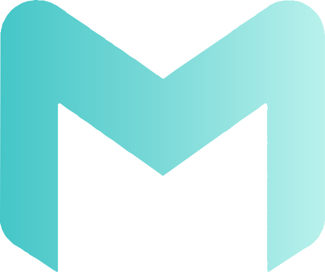
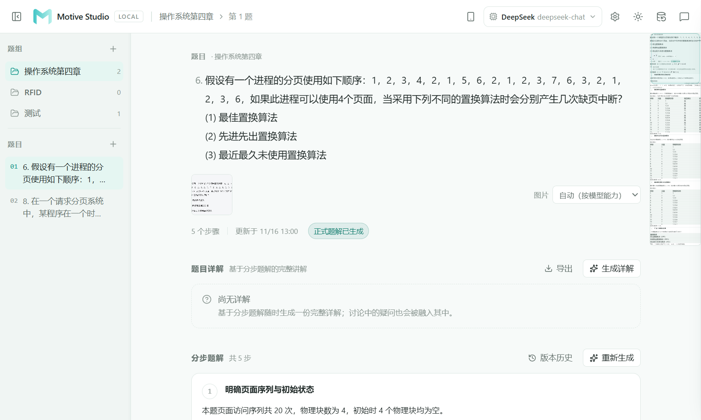
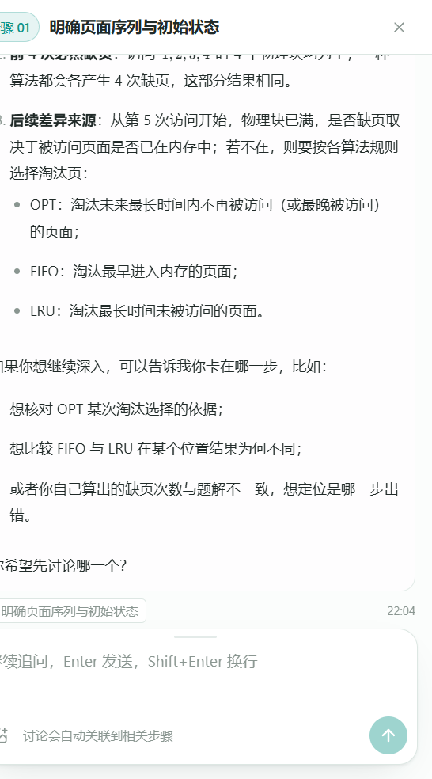
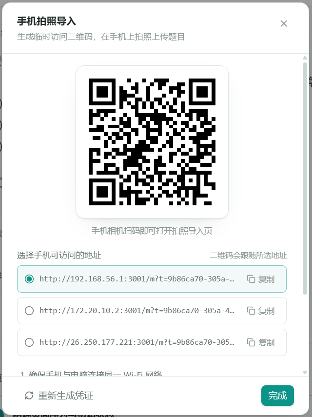
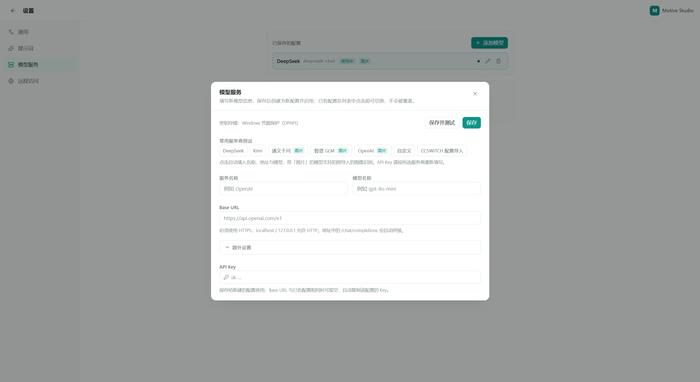

<div align="center">

<picture>
  <source media="(prefers-color-scheme: dark)" srcset="apps/web/public/logo-dark.svg" />
  
</picture>

# Motive Studio

**A local-first AI workbench for structured thinking**

Built for personal learning: question capture, AI step-by-step solving, step-level discussion, and knowledge consolidation in a single local app. Your data stays on your machine; the model service is configured by you.

English | [简体中文](./README.zh-CN.md)


</div>

## Overview

Motive Studio is organized around "question groups → questions → solution steps" and covers the full journey of a single question from capture to consolidation:

- **Capture**: enter questions by phone camera (QR pairing), desktop paste, or image selection, with region cropping before recognition.
- **Solve**: AI generates a structured step-by-step solution with SSE streaming; revise inline, diff, and restore revisions.
- **Discuss**: ask follow-ups on a single step — with optional image attachments pasted or selected right in the chat; question, step, and image context are attached automatically, and replies are linked back to related steps.
- **Explain**: generate a full explanation with summary on top of the steps, keeping status, token usage, and prompt snapshots for traceability.
- **Export**: per-question / per-group Markdown export; full workspace JSON backup export and import.
- **Local-first**: single-file SQLite database and local file storage, no cloud dependency; only model requests carry question context.

## Features

| Module | Capability | Details |
| --- | --- | --- |
| Question capture | Photo & image import | Phone QR pairing to a LAN capture page; desktop paste and file selection; up to 4 images per batch, max 6 MB each |
| Question capture | Crop editor | Region selection, drag to move, eight-way resize, and rule-of-thirds guides with unified mouse/touch interaction |
| Question capture | AI structured recognition | Multimodal model turns images into structured questions; multiple questions per import |
| Step solving | Streaming generation | Context built from question content and image policy; SSE incremental output with interrupt/stop |
| Step solving | Revisions & versions | Editable step content; every revision creates a version you can view and restore |
| Explanation | Summary & full write-up | Generates an explanation plus summary on top of the steps, keeping status, token usage, and prompt snapshots |
| Step discussion | Context-aware chat | Follow-up questions per step with auto-built question / step / image context, streamed replies |
| Step discussion | Image attachments | Paste or select images directly in the chat; attachments are stored locally and shown with the message |
| Step discussion | Step linking | Replies are automatically tagged with related steps for easy backtracking |
| Model profiles | Multi-config profiles | Save multiple OpenAI-compatible model configurations, each with its own API key; add / edit / delete on the settings page, quick-switch from the top bar |
| Model profiles | Per-purpose model | Optionally pick a separate model just for the discussion panel; solving and explanations always use the main model |
| Export & backup | Markdown / JSON | Markdown for questions and groups; complete workspace JSON backup export / import |
| Rendering | Formulas & diagrams | Streamdown + KaTeX render GFM tables, code blocks, LaTeX formulas, and Mermaid diagrams with a zoom preview |
| Workspace | Content minimap | VSCode-style overview scrollbar for the main content column |
| UI language | Bilingual UI | Switch between 简体中文 and English in the settings page; the preference persists with your local data |
| Custom prompts | Per-stage overrides | All four AI stages (question recognition / solution / discussion / explanation) accept custom system prompts; leave blank to use the built-in defaults |
| Safety & comfort | Key protection & theme | API keys protected by the OS credential store; light/dark theme follows the system and remembers your choice |

## Screenshots

<div align="center">

**Main workspace · three-column layout**: question groups → questions → step-by-step solution; the UI follows the system light/dark theme

<picture>
  <source media="(prefers-color-scheme: dark)" srcset="docs/screenshots/workspace-dark-main.png" />
  
</picture>

<br/>

<table>
  <tr>
    <td align="center" width="33.3%">
      <br/>
      <sub><b>Discussion panel</b> · ask follow-ups with full context attached automatically</sub>
    </td>
    <td align="center" width="33.3%">
      <br/>
      <sub><b>Mobile capture</b> · QR pairing over LAN; images never touch the cloud</sub>
    </td>
    <td align="center" width="33.3%">
      <br/>
      <sub><b>Model profiles</b> · multiple configurations, per-config keys, OpenAI-compatible endpoints</sub>
    </td>
  </tr>
</table>

</div>

## Tech Stack

The project is an npm-workspaces monorepo; frontend and backend share one set of TypeScript types and protocol definitions.

| Layer | Technology | Responsibility |
| --- | --- | --- |
| Frontend `apps/web` | React 19 · Vite 8 · Tailwind CSS v4 · Zustand · Streamdown | Workspace UI, SSE streaming, Markdown / formula rendering |
| Backend `apps/server` | Express 5 · node:sqlite · tsx | REST API, SSE, model calls, credentials and file storage |
| Shared `packages/shared` | TypeScript | Domain types, SSE event protocol, API contracts |
| Tooling & tests | TypeScript 5.9 (strict) · Vitest 5 · npm workspaces | Type checking, unit and integration tests |

## Architecture

```text
┌──────────────────────────────────────────────────┐
│  Web client  apps/web                             │
│  React 19 · Vite · Zustand · Streamdown           │
└───────────────────────┬──────────────────────────┘
                        │ HTTP / SSE (/api)
┌───────────────────────▼──────────────────────────┐
│  API server  apps/server                          │
│  Express 5: routes → services → repositories      │
└──────────┬──────────────────────┬────────────────┘
           │                      │
┌──────────▼──────────┐  ┌────────▼────────────────┐
│ node:sqlite          │  │ Local files              │
│ data/motive.db       │  │ data/uploads             │
│                      │  │ data/secrets             │
└──────────────────────┘  └─────────────────────────┘
                        │ HTTPS
┌───────────────────────▼──────────────────────────┐
│  OpenAI Chat Completions-compatible model service │
└──────────────────────────────────────────────────┘
```

Core data flows:

1. **Image import**: images are written to `data/uploads` and registered in `assets`; the model recognizes them into questions linked via `question_assets`.
2. **Step solving**: context is built from question content and image policy; steps stream into `solution_steps`, and edits append to `solution_revisions`.
3. **Step discussion**: question + step + image context is assembled for streaming replies; attachments are stored in `assets` and linked via `turn_assets`; related steps are parsed afterwards into `turn_step_tags`.
4. **Explanation**: discussion turns are summarized into a full write-up stored in `solution_explanations`.

## Data Model

| Domain | Main tables |
| --- | --- |
| Question bank | `question_groups`, `questions`, `assets`, `question_assets` |
| Solving | `solution_steps`, `solution_revisions` |
| Discussion | `sub_conversations`, `conversation_turns`, `turn_step_tags`, `turn_assets` |
| Explanation | `solution_explanations`, `explanation_turns` |
| Config & audit | `app_settings`, `ai_context_snapshots`, `app_meta` |

The database upgrades itself through versioned migrations (`PRAGMA user_version`); a set of sample data is seeded on first start so you can try everything immediately.

## Getting Started

### Requirements

- Node.js **≥ 24** (uses the built-in `node:sqlite`; no extra database needed)
- npm (ships with Node.js)

### Install & run

```bash
# 1. Install dependencies
npm install

# 2. Development mode: frontend + backend together
npm run dev
# Web  http://localhost:5173
# API  http://localhost:3001 (Vite proxies /api)

# 3. Production mode
npm run build
npm start
# Open http://localhost:3001 (backend serves the built frontend)
```

### First-time configuration

Open the **settings page** from the gear icon in the top bar:

- **Model service**: shows your saved model configurations. Click "Add model" to create one — base URL, model name, and API key for any OpenAI-compatible endpoint (paste-import from CCSWITCH is supported); optionally temperature, max output tokens, and vision support. Each configuration keeps its own API key in the OS credential store; existing rows can be edited or deleted, and clicking a row switches to it instantly.
- **Discussion model**: by default the discussion panel uses the main model above; optionally pick a different configuration just for chats. Solving and explanations always use the main model.
- **General**: switch the UI language (简体中文 / English) and the light/dark theme.
- **Prompts**: customize the system prompt per AI stage (question recognition / solution / discussion / explanation). Leave blank or press "restore default" to use the built-in prompt; customized prompts are snapshotted together with each generation for traceability.

The top bar also has a model dropdown for quick switching between saved configurations.

### Environment variables

| Variable | Default | Description |
| --- | --- | --- |
| `HOST` | `0.0.0.0` | Listen address; keep `0.0.0.0` so the phone capture page is reachable over the LAN |
| `PORT` | `3001` | API server port |
| `NODE_ENV` | `development` | Set to `production` to serve the `apps/web/dist` static build |

Runtime data goes into the `data/` directory at the repo root (gitignored):

```text
data/
├─ motive.db      # SQLite database (WAL mode)
├─ uploads/       # question images and uploads
└─ secrets/       # encrypted credential files (when the OS store is unavailable)
```

### Common scripts

| Script | Purpose |
| --- | --- |
| `npm run dev` | Start frontend (5173) and backend (3001) together with hot reload |
| `npm run dev:web` | Frontend only |
| `npm run dev:server` | Backend only |
| `npm run build` | Build the frontend (includes `tsc` type check) |
| `npm start` | Start the backend in production and serve the frontend |
| `npm run typecheck` | TypeScript type check for the whole repo |
| `npm run test` | Run all unit and integration tests (Vitest) |
| `npm run dev:desktop` | Desktop dev mode (reuses the dev servers + an Electron window) |
| `npm run build:desktop` | Build the frontend and the desktop server bundle |
| `npm run dist:desktop` | Package the Windows desktop app in one shot (NSIS + Portable) |

## Desktop app

Motive Studio ships an Electron-based Windows desktop version (NSIS installer and portable build). It embeds the existing Express server (running in an Electron Utility Process); the business code is fully shared with the web version and no API contract or data model changes.

### Development & packaging

```bash
npm run dev:desktop    # Desktop dev mode: reuse the web + server dev servers; Electron loads the Vite page
npm run build:desktop  # Build the frontend + self-contained server bundle (esbuild)
npm run dist:desktop   # One-shot packaging: build + electron-builder; output in apps/desktop/release/
```

### Runtime & data directory

- **NSIS installer**: per-user install (no admin required), supports in-place upgrades; uninstalling keeps user data;
- **Portable**: single-file executable; replacing or deleting the EXE does not affect data;
- Both share the same data directory `%APPDATA%/Motive Studio`:

```text
Motive Studio/
├─ motive.db      # SQLite database (WAL mode)
├─ uploads/       # question images
├─ secrets/       # encrypted credential files (Windows DPAPI)
├─ logs/          # desktop runtime logs
└─ backups/       # backup directory
```

### Desktop-specific behavior

- The main API listens only on `127.0.0.1` with a fixed default port `39217` (overridable via the `MOTIVE_PORT` environment variable), so the browser origin — and with it localStorage preferences such as theme, language, and panel widths — stays stable across restarts; if the port is occupied the server falls back to an OS-assigned random port (only for `EADDRINUSE`; other listen errors abort startup), UI preferences are then restored from the server-side settings;
- Mobile capture LAN listener is off by default: it starts on a separate port (mobile routes only, the full API never leaves the loopback) when "Mobile capture" is clicked, and closes automatically after 30 minutes of inactivity, clearing pairing tokens;
- Closing the window quits the app; the server shuts down gracefully (in-flight streaming requests finish, forced cleanup after 5 seconds);
- The renderer runs sandboxed (Context Isolation on, no Node APIs); external links open in the system browser.

### Building behind a restricted network

Electron and electron-builder binary downloads honor mirror environment variables (download source only; inject them on the command line, never commit them):

```bash
ELECTRON_MIRROR=https://npmmirror.com/mirrors/electron/
ELECTRON_BUILDER_BINARIES_MIRROR=https://npmmirror.com/mirrors/electron-builder-binaries/
NODE_OPTIONS=--use-system-ca   # environments with TLS certificate interception
```

## Mobile capture

1. Click "Mobile capture" on the desktop; a LAN pairing QR code is generated.
2. Scan it with your phone to open the `/m` capture page and pair once per session (the token is kept in memory and valid for 24 hours).
3. Take photos or pick images; the client compresses and uploads them automatically, up to 4 per batch.
4. Tap a thumbnail to open the crop editor, select the question region, and replace the original image.
5. On submit, the desktop calls the model to recognize the questions and writes them into the chosen group.

The pairing and QR-code endpoints only accept loopback calls from the local machine, and the QR target address must point at it; the mobile page and its API all require a session token, which lives only in memory and expires after 24 hours or on server restart.

## Security & privacy

- **Credential storage**: Windows uses DPAPI, macOS uses Keychain, Linux prefers Secret Service; when unavailable it falls back to a local AES-256-GCM encrypted file, never to plaintext.
- **Keys never leave the machine**: the API key never appears in any API response, backup file, or log; the settings UI only shows key presence (never the secret itself).
- **Mobile access control**: the capture page requires a session token; the server validates QR addresses and request origins; tokens expire on restart.
- **Data boundary**: questions, images, solutions, and discussions stay on your machine; only explicit model requests send the necessary context to the configured service.
- **Backup scope**: JSON backups contain workspace business data only (groups, questions, steps, revisions, discussions, tags, explanations, and discussion images) — never model settings, prompt preferences, or keys.

## API overview

All endpoints are prefixed with `/api`; errors are returned as `{ code, message }`.

| Path | Method | Description |
| --- | --- | --- |
| `/api/health` | GET | Health check |
| `/api/bootstrap` | GET | Initial workspace snapshot |
| `/api/question-groups` | POST / PATCH / DELETE | Group CRUD |
| `/api/questions` | POST / PATCH / DELETE | Question CRUD, image policy |
| `/api/question-groups/:id/image-import` | POST | Recognize images and import questions |
| `/api/questions/:id/assets` | GET / POST / DELETE | Question image assets |
| `/api/questions/:id/solution/generate` | POST | Stream a step-by-step solution |
| `/api/questions/:id/revisions` | GET | List solution revisions |
| `/api/questions/:id/explanations/generate` | POST | Generate the explanation |
| `/api/steps/:id/conversation` | GET | Load the conversation for a step |
| `/api/steps/:id/messages/stream` | POST | Step-context streaming chat (supports image attachments) |
| `/api/exports/questions/:id` | GET | Export one question as Markdown |
| `/api/exports/groups/:id` | GET | Export a group as Markdown |
| `/api/backup` | GET | Export the workspace JSON backup |
| `/api/backup/import` | POST | Import and replace workspace data |
| `/api/settings/provider` | GET / PUT | Read / save model provider settings |
| `/api/settings/provider/test` | POST | Test model connectivity |
| `/api/settings/provider/profiles` | GET / POST | List configurations / create a new one (with optional API key) |
| `/api/settings/provider/profiles/:id` | PUT / DELETE | Update / delete a configuration |
| `/api/settings/provider/profiles/:id/key` | DELETE | Clear a configuration's API key |
| `/api/settings/provider/profiles/switch` | POST | Switch the active configuration |
| `/api/settings/provider/profiles/import` | POST | Copy-import external configurations |
| `/api/settings/provider/chat-model` | GET / PUT | Read / set the discussion-only model |
| `/api/settings/prompts` | GET / PUT | Read / save per-stage custom prompts (empty string = default) |
| `/api/settings/ui` | GET / PUT | Read / partially update UI preferences (language, theme mode) |
| `/api/mobile/link` | POST | Generate the mobile pairing link and QR code |
| `/m` | GET | Mobile capture page |

## Project structure

```text
motive-studio/
├─ apps/
│  ├─ web/                       # React frontend workspace
│  │  └─ src/
│  │     ├─ features/            # groups · solving · discussion · capture · settings · theme
│  │     ├─ components/          # shared components and Markdown rendering
│  │     ├─ stores/              # Zustand state
│  │     └─ lib/                 # API client, i18n dictionaries, utilities
│  ├─ server/                    # Express API service
│     └─ src/
│        ├─ routes/              # REST / SSE routes
│        ├─ services/            # AI, credentials, assets, export, mobile sessions
│        ├─ repositories/        # data access
│        ├─ db/                  # migrations, seed data, connection management
│        ├─ desktop.ts           # desktop server entry (loaded by the Electron Utility Process)
│        └─ mobile/page.ts       # mobile capture page (single embedded file)
│  └─ desktop/                   # Electron desktop shell
│     ├─ main/                   # main process and Utility Process entries
│     ├─ scripts/                # runtime verification / packaging / icons / dev orchestration
│     ├─ build/                  # packaging assets (icon.ico)
│     └─ dist/                   # build output (server bundle, gitignored)
├─ packages/shared/              # shared types and protocols
├─ scripts/                      # dev / start scripts
├─ docs/screenshots/             # README screenshots
└─ data/                         # generated at runtime: database, images, credentials
```

## Testing

```bash
npm run typecheck
npm run test
```

Tests use Vitest. The server covers route integration, SSE parsing, credential storage, AI generators, image import, provider profiles, export, and backup; the web app covers theme, the preference write queue, and i18n dictionaries. Please add tests alongside new business logic.

## Acknowledgements

- Markdown and streaming rendering: [Streamdown](https://streamdown.ai) + [KaTeX](https://katex.org)
- Icons: [Lucide](https://lucide.dev)
- Badges: [Shields.io](https://shields.io)
- The brand logo is a hand-drawn project asset that switches with the light/dark theme (`apps/web/public/logo-light.svg`, `logo-dark.svg`)
