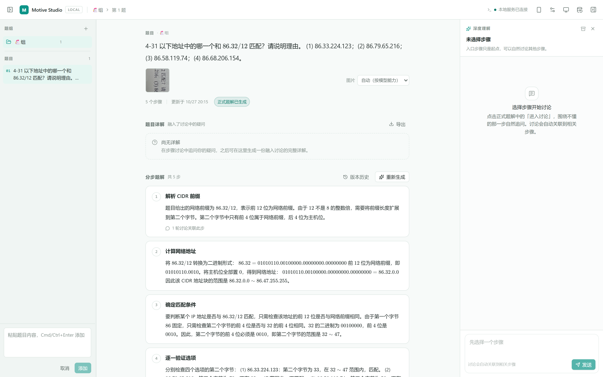
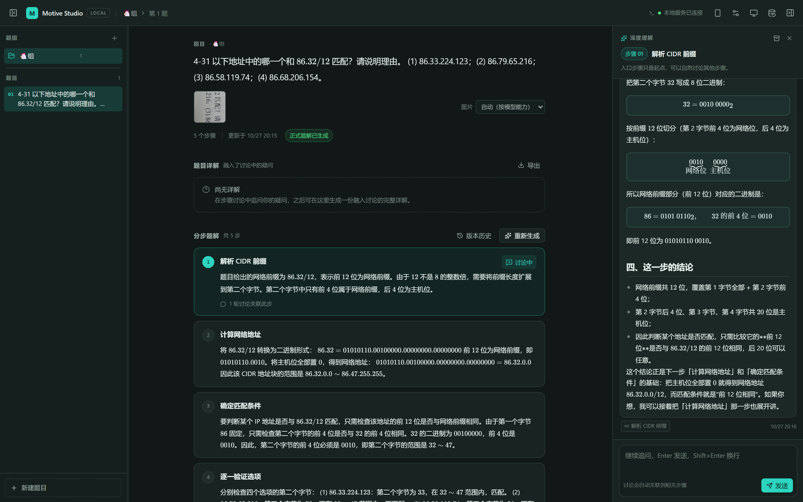
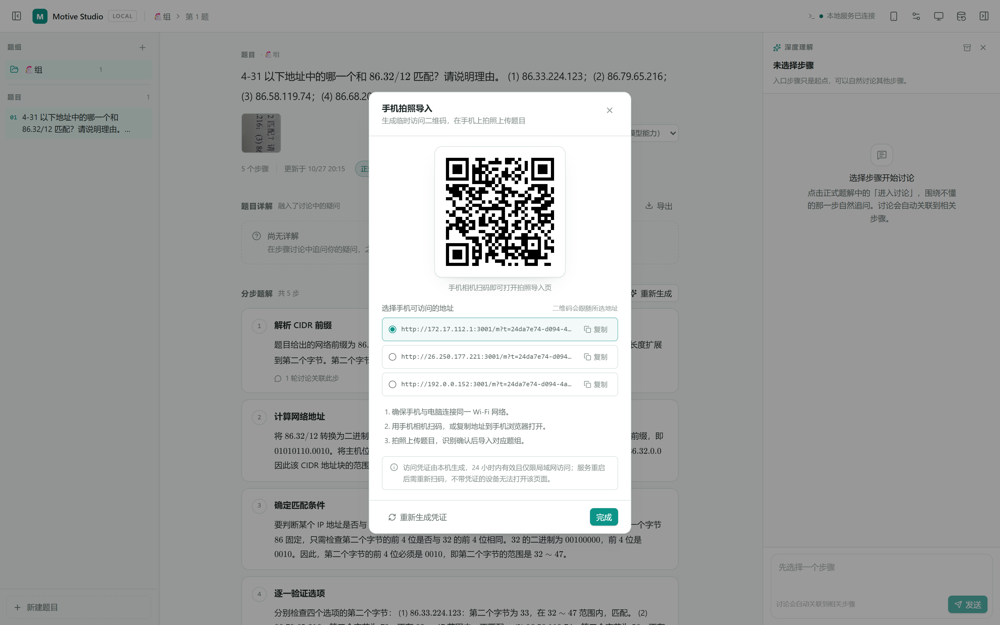
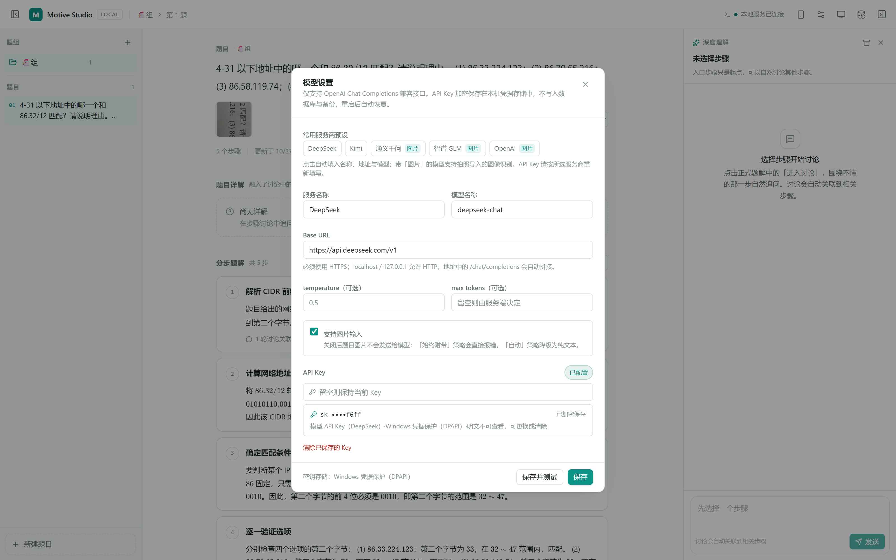

<div align="center">

<picture>
  <source media="(prefers-color-scheme: dark)" srcset="apps/web/public/logo-dark.svg" />
  
</picture>

# Motive Studio

**A local-first AI workbench for structured thinking**

Built for personal learning: question capture, AI step-by-step solving, step-level discussion, and knowledge archiving in a single local app. Your data stays on your machine; the model service is configured by you.

English | [简体中文](./README.zh-CN.md)


</div>

## Overview

Motive Studio is organized around "question groups → questions → solution steps" and covers the full journey of a single question from capture to consolidation:

- **Capture**: enter questions by phone camera (QR pairing), desktop paste, or image selection, with region cropping before recognition.
- **Solve**: AI generates a structured step-by-step solution with SSE streaming; revise inline, diff, and restore revisions.
- **Discuss**: ask follow-ups on a single step; question, step, and optional image context are attached automatically, and replies are linked back to related steps.
- **Explain & archive**: generate a full explanation with summary, propose archive changes based on the discussion, and apply them back into the solution after confirmation.
- **Export**: per-question / per-group Markdown export; full workspace JSON backup export and import.
- **Local-first**: single-file SQLite database and local file storage, no cloud dependency; only model requests carry question context.

## Features

| Module | Capability | Details |
| --- | --- | --- |
| Question capture | Photo & image import | Phone QR pairing to a LAN capture page; desktop paste and file selection; up to 4 images per batch, max 6 MB each |
| Question capture | Crop editor | Region selection, drag to move, eight-way resize, and rule-of-thirds guides with unified mouse/touch interaction |
| Question capture | AI structured recognition | Multimodal model turns images into structured questions; multiple questions per import |
| Step solving | Streaming generation | Context built from question content and image policy; SSE incremental output with interrupt/stop |
| Step solving | Revisions & versions | Editable step content; every revision creates a version you can view and restore |
| Explanation | Summary & full write-up | Generates an explanation plus summary on top of the steps, keeping status, token usage, and prompt snapshots |
| Step discussion | Context-aware chat | Follow-up questions per step with auto-built question / step / image context, streamed replies |
| Step discussion | Step linking | Replies are automatically tagged with related steps for easy backtracking |
| Archiving | Change proposals | AI proposes solution updates from the discussion; apply or reject them |
| Export & backup | Markdown / JSON | Markdown for questions and groups; complete workspace JSON backup export / import |
| Rendering | Formulas & Markdown | Streamdown + KaTeX render GFM tables, code blocks, and LaTeX formulas, tolerant of unclosed streaming content |
| UI language | Bilingual UI | Switch between 简体中文 and English in the settings page; the preference persists with your local data |
| Custom prompts | Per-stage overrides | All five AI stages (question recognition / solution / discussion / explanation / archiving) accept custom system prompts; leave blank to use the built-in defaults |
| Safety & comfort | Key protection & theme | API keys protected by the OS credential store; light/dark theme follows the system and remembers your choice |

## Screenshots

<div align="center">

**Main workspace · three-column layout**: question groups → questions → step-by-step solution; the UI follows the system light/dark theme

<picture>
  <source media="(prefers-color-scheme: dark)" srcset="docs/screenshots/workspace-dark-main.png" />
  
</picture>

<br/>

<table>
  <tr>
    <td align="center" width="33.3%">
      <br/>
      <sub><b>Discussion panel</b> · ask follow-ups with full context attached automatically</sub>
    </td>
    <td align="center" width="33.3%">
      <br/>
      <sub><b>Mobile capture</b> · QR pairing over LAN; images never touch the cloud</sub>
    </td>
    <td align="center" width="33.3%">
      <br/>
      <sub><b>Provider settings</b> · OpenAI-compatible endpoint, system-encrypted API key</sub>
    </td>
  </tr>
</table>

</div>

## Tech Stack

The project is an npm-workspaces monorepo; frontend and backend share one set of TypeScript types and protocol definitions.

| Layer | Technology | Responsibility |
| --- | --- | --- |
| Frontend `apps/web` | React 19 · Vite 8 · Tailwind CSS v4 · Zustand · Streamdown | Workspace UI, SSE streaming, Markdown / formula rendering |
| Backend `apps/server` | Express 5 · node:sqlite · tsx | REST API, SSE, model calls, credentials and file storage |
| Shared `packages/shared` | TypeScript | Domain types, SSE event protocol, API contracts |
| Tooling & tests | TypeScript 5.9 (strict) · Vitest 5 · npm workspaces | Type checking, unit and integration tests |

## Architecture

```text
┌──────────────────────────────────────────────────┐
│  Web client  apps/web                             │
│  React 19 · Vite · Zustand · Streamdown           │
└───────────────────────┬──────────────────────────┘
                        │ HTTP / SSE (/api)
┌───────────────────────▼──────────────────────────┐
│  API server  apps/server                          │
│  Express 5: routes → services → repositories      │
└──────────┬──────────────────────┬────────────────┘
           │                      │
┌──────────▼──────────┐  ┌────────▼────────────────┐
│ node:sqlite          │  │ Local files              │
│ data/motive.db       │  │ data/uploads             │
│                      │  │ data/secrets             │
└──────────────────────┘  └─────────────────────────┘
                        │ HTTPS
┌───────────────────────▼──────────────────────────┐
│  OpenAI Chat Completions-compatible model service │
└──────────────────────────────────────────────────┘
```

Core data flows:

1. **Image import**: images are written to `data/uploads` and registered in `assets`; the model recognizes them into questions linked via `question_assets`.
2. **Step solving**: context is built from question content and image policy; steps stream into `solution_steps`, and edits append to `solution_revisions`.
3. **Step discussion**: question + step + image context is assembled for streaming replies; related steps are parsed afterwards into `turn_step_tags`.
4. **Archiving**: discussion turns are summarized into `archive_proposals`; applying writes updates back, rejecting keeps the original solution.

## Data Model

| Domain | Main tables |
| --- | --- |
| Question bank | `question_groups`, `questions`, `assets`, `question_assets` |
| Solving | `solution_steps`, `solution_revisions` |
| Discussion | `sub_conversations`, `conversation_turns`, `turn_step_tags` |
| Explanation & archive | `solution_explanations`, `explanation_turns`, `archive_proposals` |
| Config & audit | `app_settings`, `ai_context_snapshots`, `app_meta` |

The database upgrades itself through versioned migrations (`PRAGMA user_version`); a set of sample data is seeded on first start so you can try everything immediately.

## Getting Started

### Requirements

- Node.js **≥ 24** (uses the built-in `node:sqlite`; no extra database needed)
- npm (ships with Node.js)

### Install & run

```bash
# 1. Install dependencies
npm install

# 2. Development mode: frontend + backend together
npm run dev
# Web  http://localhost:5173
# API  http://localhost:3001 (Vite proxies /api)

# 3. Production mode
npm run build
npm start
# Open http://localhost:3001 (backend serves the built frontend)
```

### First-time configuration

Open the **settings page** from the gear icon in the top bar:

- **Model service**: fill in your OpenAI-compatible endpoint — base URL, model name, and API key; optionally temperature, max output tokens, and vision support. The key is protected by the OS credential store; the UI only shows a masked preview (first 3 + last 4 characters) and the save time.
- **General**: switch the UI language (简体中文 / English) and the light/dark theme.
- **Prompts**: customize the system prompt per AI stage (question recognition / solution / discussion / explanation / archiving). Leave blank or press "restore default" to use the built-in prompt; customized prompts are snapshotted together with each generation for traceability.

### Environment variables

| Variable | Default | Description |
| --- | --- | --- |
| `HOST` | `0.0.0.0` | Listen address; keep `0.0.0.0` so the phone capture page is reachable over the LAN |
| `PORT` | `3001` | API server port |
| `NODE_ENV` | `development` | Set to `production` to serve the `apps/web/dist` static build |

Runtime data goes into the `data/` directory at the repo root (gitignored):

```text
data/
├─ motive.db      # SQLite database (WAL mode)
├─ uploads/       # question images and uploads
└─ secrets/       # encrypted credential files (when the OS store is unavailable)
```

### Common scripts

| Script | Purpose |
| --- | --- |
| `npm run dev` | Start frontend (5173) and backend (3001) together with hot reload |
| `npm run dev:web` | Frontend only |
| `npm run dev:server` | Backend only |
| `npm run build` | Build the frontend (includes `tsc` type check) |
| `npm start` | Start the backend in production and serve the frontend |
| `npm run typecheck` | TypeScript type check for the whole repo |
| `npm run test` | Run all unit and integration tests (Vitest) |

## Mobile capture

1. Click "Mobile capture" on the desktop; a LAN pairing QR code is generated.
2. Scan it with your phone to open the `/m` capture page and pair once per session (the token is kept in memory and valid for 24 hours).
3. Take photos or pick images; the client compresses and uploads them automatically, up to 4 per batch.
4. Tap a thumbnail to open the crop editor, select the question region, and replace the original image.
5. On submit, the desktop calls the model to recognize the questions and writes them into the chosen group.

The pairing and QR-code endpoints only accept loopback calls from the local machine, and the QR target address must point at it; the mobile page and its API all require a session token, which lives only in memory and expires after 24 hours or on server restart.

## Security & privacy

- **Credential storage**: Windows uses DPAPI, macOS uses Keychain, Linux prefers Secret Service; when unavailable it falls back to a local AES-256-GCM encrypted file, never to plaintext.
- **Keys never leave the machine**: the API key never appears in any API response, backup file, or log; the settings UI only offers a masked preview.
- **Mobile access control**: the capture page requires a session token; the server validates QR addresses and request origins; tokens expire on restart.
- **Data boundary**: questions, images, solutions, and archives stay on your machine; only explicit model requests send the necessary context to the configured service.
- **Backup scope**: JSON backups contain workspace business data only (groups, questions, steps, revisions, discussions, tags, explanations, and archive proposals) — never model settings, prompt preferences, or keys.

## API overview

All endpoints are prefixed with `/api`; errors are returned as `{ code, message }`.

| Path | Method | Description |
| --- | --- | --- |
| `/api/health` | GET | Health check |
| `/api/bootstrap` | GET | Initial workspace snapshot |
| `/api/question-groups` | POST / PATCH / DELETE | Group CRUD |
| `/api/questions` | POST / PATCH / DELETE | Question CRUD, image policy |
| `/api/question-groups/:id/image-import` | POST | Recognize images and import questions |
| `/api/questions/:id/solution/generate` | POST | Stream a step-by-step solution |
| `/api/questions/:id/revisions` | GET | List solution revisions |
| `/api/questions/:id/explanations/generate` | POST | Generate the explanation |
| `/api/steps/:id/messages/stream` | POST | Step-context streaming chat |
| `/api/questions/:id/archive-proposals` | GET | List archive proposals |
| `/api/archive-proposals/:id/apply` | POST | Apply an archive proposal |
| `/api/exports/questions/:id` | GET | Export one question as Markdown |
| `/api/exports/groups/:id` | GET | Export a group as Markdown |
| `/api/backup` | GET | Export the workspace JSON backup |
| `/api/backup/import` | POST | Import and replace workspace data |
| `/api/settings/provider` | GET / PUT | Read / save model provider settings |
| `/api/settings/provider/test` | POST | Test model connectivity |
| `/api/settings/prompts` | GET / PUT | Read / save per-stage custom prompts (empty string = default) |
| `/api/settings/ui` | GET / PUT | Read / partially update UI preferences (language, theme mode) |
| `/api/mobile/link` | POST | Generate the mobile pairing link and QR code |
| `/m` | GET | Mobile capture page |

## Project structure

```text
motive-studio/
├─ apps/
│  ├─ web/                       # React frontend workspace
│  │  └─ src/
│  │     ├─ features/            # groups · solving · discussion · archive · capture · settings · theme
│  │     ├─ components/          # shared components and Markdown rendering
│  │     ├─ stores/              # Zustand state
│  │     └─ lib/                 # API client, i18n dictionaries, utilities
│  └─ server/                    # Express API service
│     └─ src/
│        ├─ routes/              # REST / SSE routes
│        ├─ services/            # AI, credentials, assets, archive, export, mobile sessions
│        ├─ repositories/        # data access
│        ├─ db/                  # migrations, seed data, connection management
│        └─ mobile/page.ts       # mobile capture page (single embedded file)
├─ packages/shared/              # shared types and protocols
├─ scripts/                      # dev / start scripts
├─ docs/screenshots/             # README screenshots
└─ data/                         # generated at runtime: database, images, credentials
```

## Testing

```bash
npm run typecheck
npm run test
```

Tests use Vitest. The server covers route integration, SSE parsing, credential storage, AI generators, image import, archiving, export, and backup; the web app covers theme, the preference write queue, and i18n dictionaries. Please add tests alongside new business logic.

## Acknowledgements

- Markdown and streaming rendering: [Streamdown](https://streamdown.ai) + [KaTeX](https://katex.org)
- Icons: [Lucide](https://lucide.dev)
- Badges: [Shields.io](https://shields.io)
- The brand logo is a hand-drawn project asset that switches with the light/dark theme (`apps/web/public/logo-light.svg`, `logo-dark.svg`)
