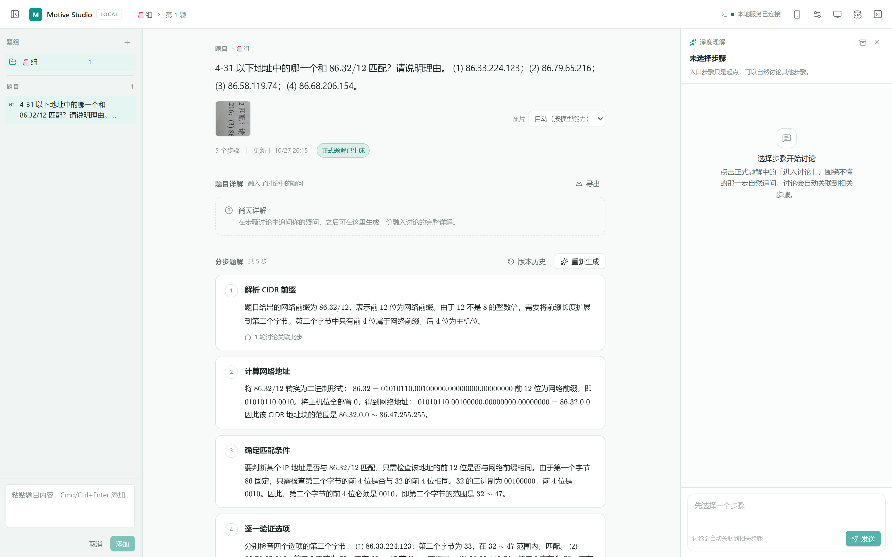
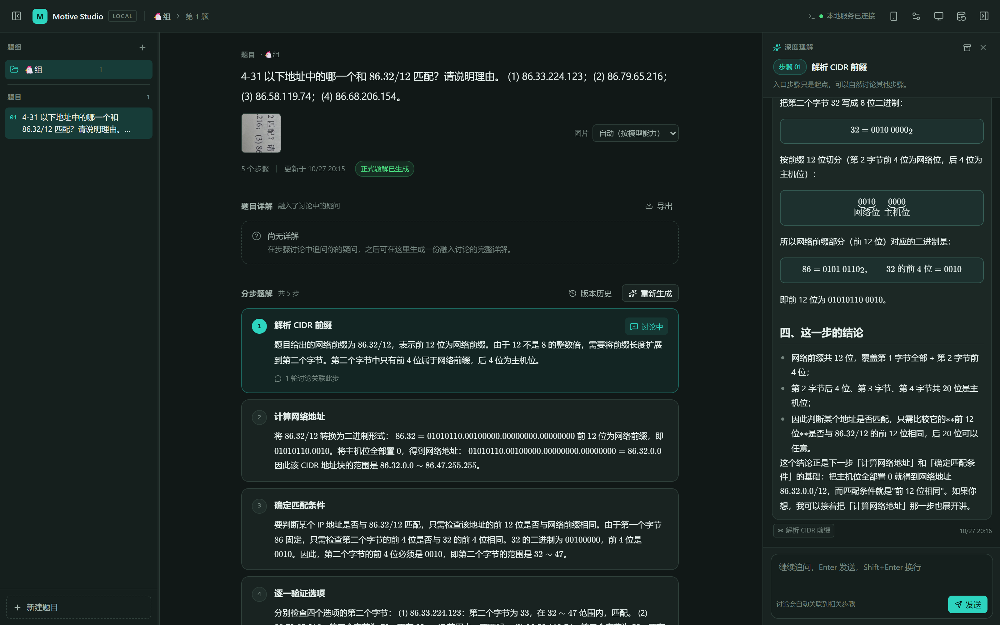
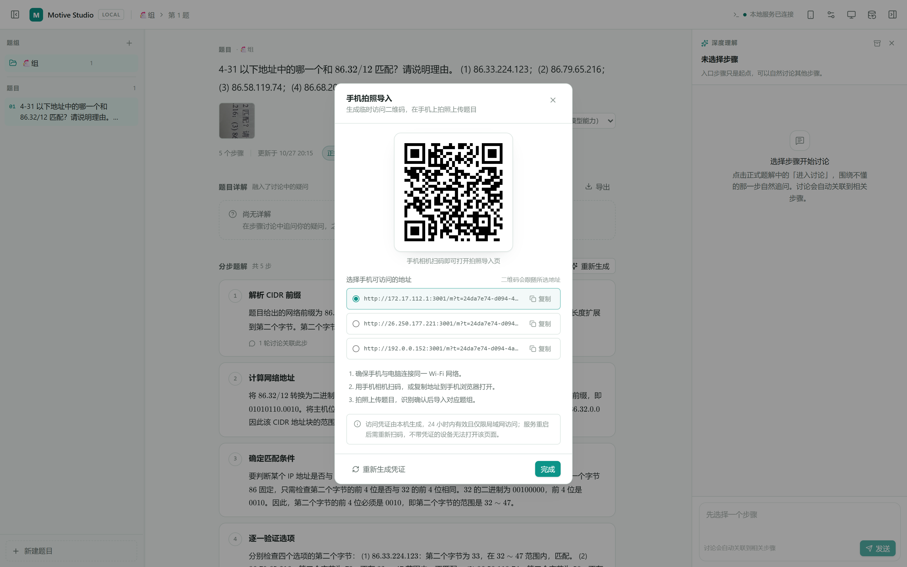
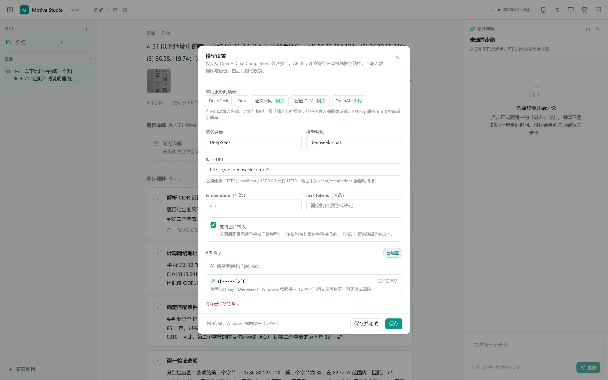

<div align="center">

<picture>
  <source media="(prefers-color-scheme: dark)" srcset="apps/web/public/logo-dark.svg" />
  
</picture>

# Motive Studio

**本地优先的 AI 结构化思考工作台**

面向个人学习场景，将题目采集、AI 分步解题、步骤级讨论与知识归档整合在同一个本地应用。业务数据保存在本机，模型服务由使用者自行配置。


</div>

## 概览

Motive Studio 以「题组 → 题目 → 解题步骤」为核心结构，围绕一道题目完成从采集到沉淀的完整流程：

- **采集**：通过手机扫码拍照、桌面端粘贴或选择图片录入题目，支持区域裁剪后识别。
- **解题**：AI 生成结构化分步题解，SSE 流式输出；支持在线修订、对比与恢复历史版本。
- **讨论**：针对单个步骤追问，自动携带题目、步骤与可选图片上下文，并将对话关联回相关步骤。
- **详解与归档**：生成题目详解摘要，基于讨论内容提出归档变更建议，经确认后写回题解。
- **沉淀**：单题 / 题组导出 Markdown，工作区数据可整体导出与导入 JSON 备份。
- **本地优先**：SQLite 单文件数据库与本地文件存储，无云端依赖；仅模型请求会携带题目上下文。

## 功能

| 模块 | 能力 | 说明 |
| --- | --- | --- |
| 题目采集 | 拍照与图片导入 | 手机扫码直连局域网拍照页，桌面端支持粘贴与选择图片，单次最多 4 张、每张不超过 6 MB |
| 题目采集 | 裁剪编辑器 | 区域框选、拖动移动、八向缩放与三分构图线，鼠标与触控统一交互 |
| 题目采集 | AI 结构化识别 | 图片经多模态模型识别后生成结构化题目，支持一次导入多道题 |
| 分步解题 | 流式生成 | 依据题目与图片策略构建上下文，SSE 增量输出，支持中断与停止 |
| 分步解题 | 修订与版本 | 可编辑步骤内容，每次修订生成版本记录，可随时查看与恢复 |
| 题目详解 | 摘要与详解 | 在分步题解基础上生成详解与摘要，保留生成状态、Token 用量与提示词快照 |
| 步骤讨论 | 上下文对话 | 围绕步骤追问，自动构建题目 / 步骤 / 图片上下文，流式返回 |
| 步骤讨论 | 步骤关联 | 对话回复完成后自动标注与相关步骤的关联，便于回溯 |
| 归档整理 | 变更建议 | AI 依据讨论内容提出题解修改建议，确认后应用，支持驳回 |
| 导出备份 | Markdown / JSON | 题目与题组导出 Markdown；工作区完整导出 / 导入 JSON 备份 |
| 内容渲染 | 公式与 Markdown | Streamdown + KaTeX 渲染 GFM 表格、代码块与 LaTeX 公式，兼容流式未闭合内容 |
| 安全与体验 | 密钥保护与主题 | API Key 使用操作系统凭据保护；明暗主题自动跟随系统并记忆偏好 |

## 界面预览

<div align="center">

**主工作台 · 三栏布局**：题组 → 题目 → 分步题解，界面随系统自动切换明暗主题

<picture>
  <source media="(prefers-color-scheme: dark)" srcset="docs/screenshots/workspace-dark-main.png" />
  
</picture>

<br/>

<table>
  <tr>
    <td align="center" width="33.3%">
      <br/>
      <sub><b>讨论面板</b> · 围绕当前步骤追问，自动携带完整上下文</sub>
    </td>
    <td align="center" width="33.3%">
      <br/>
      <sub><b>手机拍照导入</b> · 扫码配对直连局域网，图片不经云端</sub>
    </td>
    <td align="center" width="33.3%">
      <br/>
      <sub><b>模型服务设置</b> · OpenAI 兼容接口，API Key 系统级加密</sub>
    </td>
  </tr>
</table>

</div>

## 技术栈

项目采用 npm workspaces 管理的 Monorepo，前后端共享一套 TypeScript 类型与协议定义。

| 分层 | 技术 | 职责 |
| --- | --- | --- |
| 前端 `apps/web` | React 19 · Vite 8 · Tailwind CSS v4 · Zustand · Streamdown | 工作台界面、SSE 流式渲染、Markdown / 公式排版 |
| 后端 `apps/server` | Express 5 · node:sqlite · tsx | REST API、SSE、模型调用、凭据与文件存储 |
| 共享 `packages/shared` | TypeScript | 领域类型、SSE 事件协议、API 数据契约 |
| 工程与测试 | TypeScript 5.9（strict）· Vitest 5 · npm workspaces | 类型检查、单元与集成测试 |

## 系统架构

```text
┌──────────────────────────────────────────────────┐
│  Web 客户端  apps/web                             │
│  React 19 · Vite · Zustand · Streamdown           │
└───────────────────────┬──────────────────────────┘
                        │ HTTP / SSE（/api）
┌───────────────────────▼──────────────────────────┐
│  API 服务  apps/server                            │
│  Express 5：routes → services → repositories      │
└──────────┬──────────────────────┬────────────────┘
           │                      │
┌──────────▼──────────┐  ┌────────▼────────────────┐
│ node:sqlite          │  │ 本地文件                 │
│ data/motive.db       │  │ data/uploads             │
│                      │  │ data/secrets             │
└──────────────────────┘  └─────────────────────────┘
                        │ HTTPS
┌───────────────────────▼──────────────────────────┐
│  OpenAI Chat Completions 兼容模型服务             │
└──────────────────────────────────────────────────┘
```

核心数据流：

1. **图片导入**：图片写入 `data/uploads` 并登记 `assets`，模型识别后生成题目并建立 `question_assets` 关联。
2. **分步解题**：根据题目内容与图片策略构建上下文，流式生成步骤，写入 `solution_steps`，修订时追加 `solution_revisions`。
3. **步骤讨论**：构建题目 + 步骤 + 图片上下文，流式回复；完成后解析关联步骤并写入 `turn_step_tags`。
4. **归档整理**：汇总讨论记录生成 `archive_proposals`，用户确认后应用，驳回则保留原题解。

## 数据模型

| 数据域 | 主要表 |
| --- | --- |
| 题库 | `question_groups`、`questions`、`assets`、`question_assets` |
| 解题 | `solution_steps`、`solution_revisions` |
| 讨论 | `sub_conversations`、`conversation_turns`、`turn_step_tags` |
| 详解与归档 | `solution_explanations`、`explanation_turns`、`archive_proposals` |
| 配置与审计 | `app_settings`、`ai_context_snapshots`、`app_meta` |

数据库通过版本化迁移（`PRAGMA user_version`）自动升级；首次启动会写入一组示例数据，便于直接体验功能。

## 快速开始

### 环境要求

- Node.js **≥ 24**（使用内置 `node:sqlite`，无需安装额外数据库）
- npm（随 Node.js 提供）

### 安装与运行

```bash
# 1. 安装依赖
npm install

# 2. 开发模式：同时启动前端与后端
npm run dev
# 前端  http://localhost:5173
# API   http://localhost:3001（Vite 已代理 /api）

# 3. 生产模式
npm run build
npm start
# 访问 http://localhost:3001（后端托管前端静态产物）
```

### 首次配置

打开 **设置 → 模型服务**，填写 OpenAI 兼容服务信息：

- Base URL、模型名称与 API Key
- 可选：温度、最大输出 Token、是否支持图片输入

保存后密钥交由系统凭据库保护，界面仅展示脱敏预览（前 3 位 + 末 4 位）与保存时间。

### 环境变量

| 变量 | 默认值 | 说明 |
| --- | --- | --- |
| `HOST` | `0.0.0.0` | 监听地址；保持 `0.0.0.0` 才能通过局域网访问手机拍照页 |
| `PORT` | `3001` | API 服务端口 |
| `NODE_ENV` | `development` | 设为 `production` 时托管 `apps/web/dist` 静态产物 |

运行时数据统一写入仓库下的 `data/` 目录（已加入 `.gitignore`）：

```text
data/
├─ motive.db      # SQLite 数据库（WAL 模式）
├─ uploads/       # 题目图片与上传资源
└─ secrets/       # 加密凭据文件（系统凭据库不可用时）
```

### 常用脚本

| 脚本 | 作用 |
| --- | --- |
| `npm run dev` | 同时启动前端（5173）与后端（3001），支持热更新 |
| `npm run dev:web` | 仅启动前端 |
| `npm run dev:server` | 仅启动后端 |
| `npm run build` | 构建前端产物（含 `tsc` 类型检查） |
| `npm start` | 生产模式启动后端并托管前端 |
| `npm run typecheck` | 全仓 TypeScript 类型检查 |
| `npm run test` | 运行全部单元与集成测试（Vitest） |

## 手机拍照导入

1. 桌面端点击「手机拍照」，生成局域网配对二维码。
2. 手机扫码进入 `/m` 拍照页，完成一次会话内配对（凭证内存保存，24 小时有效）。
3. 拍照或选择图片，客户端自动压缩后上传，单次最多 4 张。
4. 点击缩略图进入裁剪编辑器，框选题目区域并替换原图。
5. 提交后由桌面端调用模型识别，将题目结构化写入指定题组。

桌面端注册配对凭证与生成二维码的接口仅允许本机回环调用，二维码目标地址必须指向本机；移动端页面与接口均要求会话 Token，凭证仅保存在内存中，24 小时后或服务重启即失效。

## 安全与隐私

- **凭据存储**：Windows 使用 DPAPI，macOS 使用 Keychain，Linux 优先 Secret Service；不可用时降级为本地 AES-256-GCM 加密文件，不会静默退化为明文存储。
- **密钥不出域**：API Key 不会出现在任何 API 响应、备份文件或日志中；设置界面仅提供脱敏预览。
- **移动端访问控制**：拍照页要求会话 Token，服务端校验二维码地址与请求来源，凭证随服务重启失效。
- **数据边界**：题目、图片、题解与归档均保存在本机；只有显式触发的模型请求会将必要上下文发送至所配置的模型服务。
- **备份范围**：JSON 备份仅包含工作区业务数据（题组、题目、步骤、修订、讨论、标签、题解与归档建议），不包含模型设置与密钥。

## API 概览

所有接口以 `/api` 为前缀，错误响应统一为 `{ code, message }`。

| 路径 | 方法 | 说明 |
| --- | --- | --- |
| `/api/health` | GET | 健康检查 |
| `/api/bootstrap` | GET | 获取工作区初始快照 |
| `/api/question-groups` | POST / PATCH / DELETE | 题组增删改 |
| `/api/questions` | POST / PATCH / DELETE | 题目增删改、图片策略设置 |
| `/api/question-groups/:id/image-import` | POST | 图片识别并导入题目 |
| `/api/questions/:id/solution/generate` | POST | 流式生成分步题解 |
| `/api/questions/:id/revisions` | GET | 查询题解历史版本 |
| `/api/questions/:id/explanations/generate` | POST | 生成题目详解 |
| `/api/steps/:id/messages/stream` | POST | 步骤上下文流式对话 |
| `/api/questions/:id/archive-proposals` | GET | 查询归档建议 |
| `/api/archive-proposals/:id/apply` | POST | 应用归档建议 |
| `/api/exports/questions/:id` | GET | 导出单题 Markdown |
| `/api/exports/groups/:id` | GET | 导出题组 Markdown |
| `/api/backup` | GET | 导出工作区 JSON 备份 |
| `/api/backup/import` | POST | 导入并替换工作区数据 |
| `/api/settings/provider` | GET / PUT | 读取 / 保存模型服务设置 |
| `/api/settings/provider/test` | POST | 测试模型连通性 |
| `/api/mobile/link` | POST | 生成移动端配对链接与二维码 |
| `/m` | GET | 手机拍照页 |

## 目录结构

```text
motive-studio/
├─ apps/
│  ├─ web/                       # React 前端工作台
│  │  └─ src/
│  │     ├─ features/            # 题组 · 解题 · 讨论 · 归档 · 拍照 · 设置 · 主题
│  │     ├─ components/          # 共享组件与 Markdown 渲染
│  │     ├─ stores/              # Zustand 状态
│  │     └─ lib/                 # API 客户端与工具函数
│  └─ server/                    # Express API 服务
│     └─ src/
│        ├─ routes/              # REST / SSE 路由
│        ├─ services/            # AI、凭据、图片、归档、导出、移动会话
│        ├─ repositories/        # 数据访问
│        ├─ db/                  # 迁移、示例数据、连接管理
│        └─ mobile/page.ts       # 手机拍照页（单文件内嵌资源）
├─ packages/shared/              # 前后端共享类型与协议
├─ scripts/                      # dev / start 启动脚本
├─ docs/screenshots/             # README 截图
└─ data/                         # 运行时生成：数据库、图片、凭据
```

## 测试

```bash
npm run typecheck
npm run test
```

测试使用 Vitest，服务端覆盖路由集成、SSE 解析、凭据存储、AI 生成器、图片导入、归档、导出与备份等核心链路；前端覆盖主题与格式化工具。新增业务逻辑时建议同步补充对应测试。

## 致谢

- Markdown 与流式内容渲染：[Streamdown](https://streamdown.ai) + [KaTeX](https://katex.org)
- 界面图标：[Lucide](https://lucide.dev)
- 技术栈徽章：[Shields.io](https://shields.io)
- 品牌标识为项目自绘资源，随明暗主题切换（`apps/web/public/logo-light.svg`、`logo-dark.svg`）
